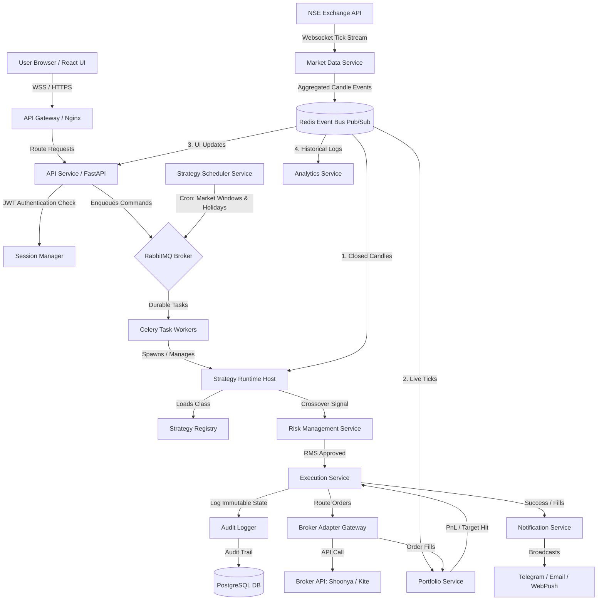

# Enterprise Options Trading SaaS Platform MVP

A production-grade, multi-tenant, cloud-native SaaS Options Trading Platform MVP built with **FastAPI**, **React (Vite)**, **Celery**, **RabbitMQ**, **Redis**, and **PostgreSQL**. 

This platform operates as an event-driven engine that aggregates real-time market ticks, computes indicators (Heikin-Ashi, WMA, SMA), triggers crossover signals, validates pre-trade risk controls, audits execution logs, and routes trades to simulated or live broker adapters.

---

## 1. System Architecture Layout

The platform follows a decoupled, service-oriented design. Services communicate asynchronously using **RabbitMQ** (for durable tasks) and **Redis** (for real-time market data distribution and WebSocket states).



---

## 2. Key Modules & Directory Structure

The project has been organized with clear separation of concerns:

```
Om Project/
├── backend/                              # Complete Backend Engine & Services
│   ├── app/                              # FastAPI Gateway, DB Models, Services & Engine
│   │   ├── broker/                       # Broker adapters (Paper Trading, Shoonya, Kite)
│   │   ├── core/                         # Config, DB connections, memory bus
│   │   ├── db/                           # SQLAlchemy relational models
│   │   ├── engine/                       # Execution engine, RMS, market data feed
│   │   ├── services/                     # Execution, portfolio math, audits, notifications
│   │   ├── strategies/                   # Registered active strategy plugins
│   │   ├── workers/                      # Celery worker tasks
│   │   ├── static/                       # Compiled production frontend build
│   │   └── main.py                       # FastAPI application & WebSocket gateway
│   ├── logics/                           # Quantitative Algorithmic Trading Logics
│   │   ├── nifty_wma5_sma1_call/         # Nifty ATM Call (WMA 5 / SMA 1) strategy & metadata
│   │   └── nifty_wma5_sma2_put/          # Nifty ATM Put (WMA 5 / SMA 2) strategy & metadata
│   ├── scripts/                          # Operational & Utility Scripts
│   │   ├── seed_demo_data.py             # Seeds paper margin, demo users & past trades
│   │   ├── simulate_market_ticks.py      # Simulated real-time market ticks
│   │   └── verify_system.py              # Automated system diagnostics check
│   ├── docs/                             # System Architecture & Design Documents
│   ├── tests/                            # Unit & Integration validation tests
│   ├── manage.py                         # CLI Command Manager (runserver, seed, test, worker)
│   ├── requirements.txt                  # Python dependencies
│   └── trading.db                        # SQLite local development database
│
└── frontend/                             # React + Vite Single Page Application
    ├── src/
    │   ├── App.jsx                       # AlgoTrade Pro UI, Segment Selector & P&L Dashboard
    │   ├── index.css                     # Outrun Glassmorphic design styles & animations
    │   └── main.jsx                      # React entrypoint
    ├── package.json                      # Frontend dependencies
    └── vite.config.js                    # Vite configuration
```

---

## 3. Local Installation & Run Guide

### Option A: Using `manage.py` (Quickest Developer Experience)

1. **Activate Virtual Environment & Install Requirements**:
   ```bash
   cd backend
   .\venv\Scripts\activate   # On Windows (or source venv/bin/activate on Linux/Mac)
   pip install -r requirements.txt
   ```

2. **Create your `.env` with fresh secrets (first time only)**:
   ```bash
   python manage.py genkeys    # writes backend/.env from .env.example; never commit it
   ```
   Database migrations run automatically when the server starts. To run them by hand: `python manage.py migrate`.
   After changing models: `python manage.py makemigrations -m "describe change"`.

3. **Run Backend Server (with auto-reload)**:
   ```bash
   python manage.py runserver
   ```
   *Dashboard and API:*
   - **Frontend UI**: [http://127.0.0.1:8000/](http://127.0.0.1:8000/)
   - **Interactive API Docs (Swagger)**: [http://127.0.0.1:8000/docs](http://127.0.0.1:8000/docs)

3. **Useful Management Commands**:
   ```bash
   python manage.py seed       # Seeds paper margin (Rs. 5,00,000) & demo trades
   python manage.py test       # Runs validation test suite
   python manage.py routes     # Displays all registered API gateway routes
   python manage.py worker     # Launches background Celery worker
   ```

4. **Frontend Development Server (Optional for hot module replacement)**:
   ```bash
   cd frontend
   npm install
   npm run dev
   ```
3.  **Start Celery Worker Node**:
    ```bash
    cd backend
    celery -A app.workers.celery_app worker --loglevel=info
    ```
4.  **Start Frontend Developer Server**:
    ```bash
    cd frontend
    npm install
    npm run dev
    ```

### Cloud server (control from your phone)

To run the platform all day without your laptop, deploy it to a small VM with HTTPS using
`docker-compose.cloud.yml`. Step-by-step guide: [docs/DEPLOY_CLOUD.md](docs/DEPLOY_CLOUD.md).

---

## 4. Telemetry, Health and Metrics

Exposes standard telemetry interfaces for infrastructure monitoring (Prometheus, Grafana, Loki):

*   **Health Check (`GET /health`)**: Returns connections state of dependencies.
    ```json
    {
      "status": "healthy",
      "database": "connected",
      "timestamp": "2026-07-09T14:47:45Z"
    }
    ```
*   **Prometheus metrics (`GET /metrics`)**: Exposes strategy execution loop metrics and trade counts.
    ```text
    # HELP active_strategy_subscriptions Total active trading subscribers
    # TYPE active_strategy_subscriptions gauge
    active_strategy_subscriptions 42
    ```

---

## 5. Verification Test Suite

Verify dynamic registry loading, HA transformations, and crossover indicator calculations:

```bash
python backend/tests/run_tests.py
```

*Output:*
```text
Running system validation tests...
[PASS] test_strategy_registration passed.
[PASS] test_indicator_calculations passed.
[PASS] test_heikin_ashi_transformation passed.

All validation tests passed successfully!
```