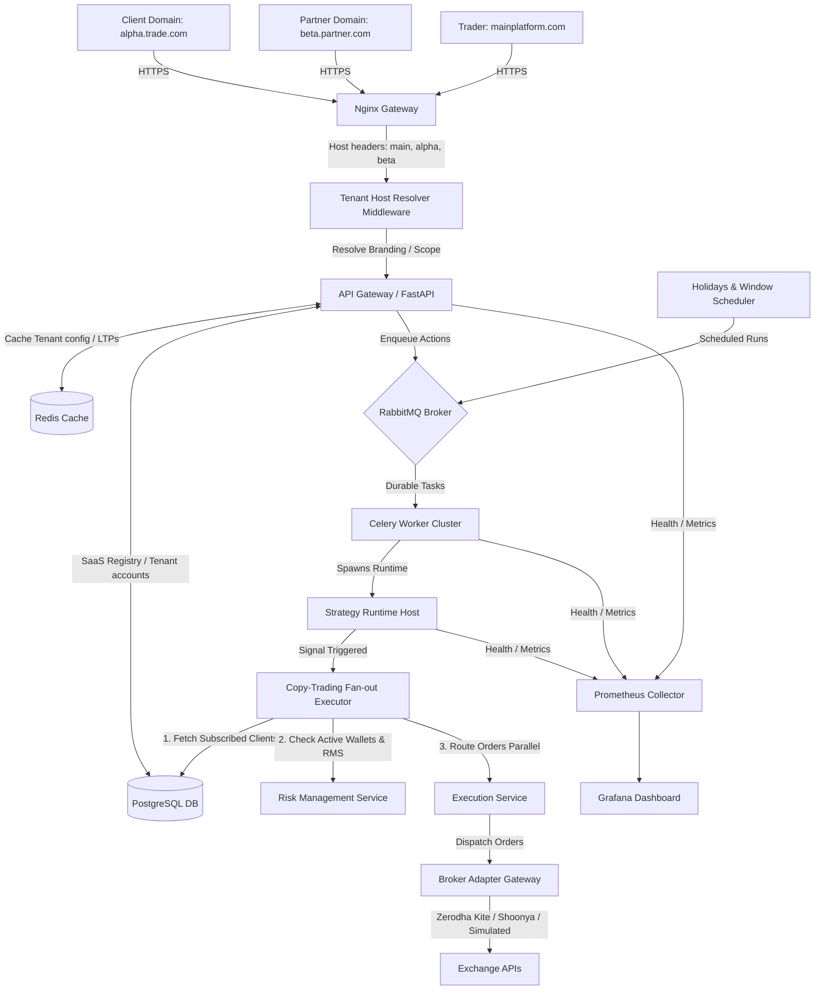
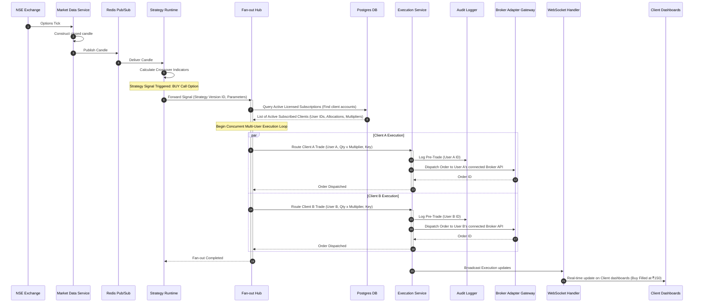
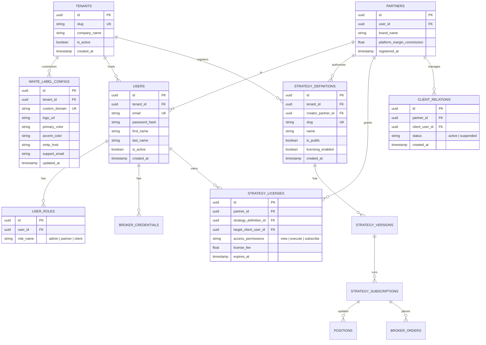

# B2B2C Multi-Tenant SaaS Trading Platform: Architecture & Design

This specification outlines the architecture, database schemas, and service topologies for a B2B2C Multi-Tenant Options Trading Platform with Strategy Marketplaces, Partner Dashboards, and White-Label branding integrations.

---

## 1. System Topology & Multi-Tenant Deployment Blueprint

The system incorporates a **Tenant Host Resolver** middleware. Requests from custom domains resolve branding, security bounds, and database isolation keys. Strategy executors utilize a **Signal Fan-out Hub** to route parent signals into concurrent broker trades for all sub-accounts.



---

## 2. Service Interaction Sequences

### Sequence A: Multi-User Copy-Trading Signal Fan-out



---

## 3. Database Schema Extensions (B2B2C Multi-Tenant ERD)



---

## 4. API Endpoints Contract (B2B2C / Tenant Extensions)

Exposes partner dashboards, licensing configurations, and white-label management.

```yaml
  /api/v1/tenant/white-label:
    get:
      summary: Retrieve custom White-Label configurations based on Host Header
      responses:
        200:
          content:
            application/json:
              schema:
                type: object
                properties:
                  company_name: { type: string }
                  logo_url: { type: string }
                  primary_color: { type: string }
                  accent_color: { type: string }
                  custom_domain: { type: string }

  /api/v1/partner/clients:
    get:
      summary: Get all clients registered under the partner account
      security: [{ BearerAuth: [] }]
      responses:
        200:
          content:
            application/json:
              schema:
                type: array
                items:
                  type: object
                  properties:
                    client_id: { type: string, format: uuid }
                    email: { type: string }
                    status: { type: string }
                    active_subscriptions_count: { type: integer }

  /api/v1/partner/licenses:
    post:
      summary: License a strategy definition to a specific client user
      security: [{ BearerAuth: [] }]
      requestBody:
        required: true
        content:
          application/json:
            schema:
              type: object
              required: [strategy_definition_id, client_user_id]
              properties:
                strategy_definition_id: { type: string, format: uuid }
                client_user_id: { type: string, format: uuid }
                license_fee: { type: number }
                expires_at: { type: string, format: date-time }
      responses:
        201:
          description: License created and strategy authorized for client
```
